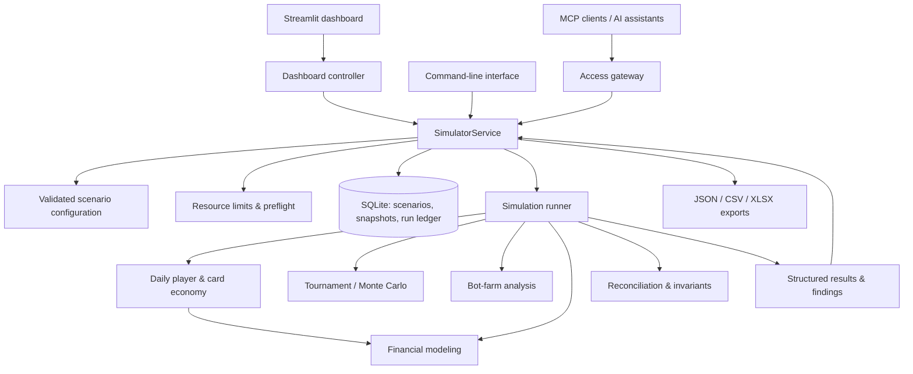
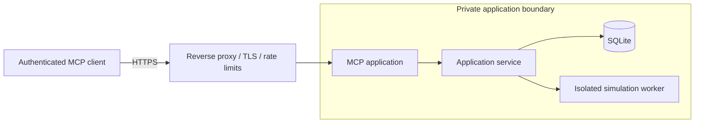

# FIGHTEX — Economic Simulation & Tokenomics Architecture

**Python simulation engine · Game economy modeling · Monte Carlo · Financial risk analysis · MCP integration**

FIGHTEX is an economic simulation architecture for a fantasy MMA/UFC-style digital collectible game. It models interactions between player behavior, virtual cards, staking rewards, crafting, marketplace trading, tournament payouts, and platform finances.

This repository is a **public, high-level architecture overview**. It intentionally excludes the proprietary simulation source code, customer datasets, complete parameter sets, detailed audit findings, infrastructure credentials, and production configuration.

## Architecture at a glance

**Core design rule:** the calculation engine is independent of the user interface, MCP transport, and database. The dashboard, CLI, and MCP integrations share one application service and simulation runner; the AI assistant interprets results rather than calculating the economics itself.

## Detailed architecture documentation

- [Simulation engine](docs/ENGINE.md) — computation layers, daily model lifecycle, financial and tournament modules.
- [MCP integration](docs/MCP.md) — AI client integration, authorization, read-only operation and deployment boundaries.
- [Reproducibility](docs/REPRODUCIBILITY.md) — immutable snapshots, run digests, audit evidence and scenario uncertainty.

## Core components

| Layer | Responsibility |
| --- | --- |
| **Configuration** | Pydantic validation, versioned baseline, parameter provenance, derived scenarios, parameter hashing |
| **Simulation engine** | Day-by-day player activity, collectible card lifecycle, FP rewards, staking, crafting, purchases, marketplace matching |
| **Tournament engine** | Scoring, team composition, synthetic or structured sports input, Monte Carlo experiments |
| **Bot-farm analysis** | Multi-account strategies, costs, realized vs. theoretical asset value, liquidation sensitivity |
| **Financial engine** | Revenue and expense flows, cash-flow ledger, payout obligations, liquidity gaps, reserve requirements |
| **Analysis** | Sensitivity experiments, scenario comparisons, rule-based findings, invariant checks |
| **Application services** | Single orchestration layer, scenario lifecycle, resource preflight, caching and result retrieval |
| **Persistence** | SQLite scenarios, immutable parameter snapshots, calculation ledger, reproducibility metadata |
| **Interfaces** | Local Streamlit dashboard, Python CLI, MCP server over stdio or HTTP |
| **Delivery** | Containerized server deployment, reverse proxy, TLS, authentication, role-based access and rate limits |

## Economic simulation workflow

The model's daily economic loop considers player onboarding, card expiry, staking rewards, advertising rewards, purchases, crafting, tournament participation, marketplace transactions, withdrawals, and accounting checks. Its inputs distinguish **customer-defined rules** from **unverified behavioral assumptions**. Simulation outputs are conditional scenarios, **not guaranteed financial forecasts**.

## Reproducibility and auditability

- A scenario derives from an immutable baseline instead of editing the original configuration.
- Parameter values carry provenance (source requirements, customer updates, or assumptions).
- Runs record the engine/configuration version, parameter hash, seed, input-data provenance, and result digest.
- Immutable configuration snapshots and an append-only run ledger preserve the basis of prior conclusions.
- Reconciliation checks cover key economic invariants and financial flows.
- Sensitivity analysis and multiple seeds help expose dependence on uncertain assumptions.

## MCP and AI-assisted analysis

The Model Context Protocol (MCP) integration enables AI clients to **inspect** model metadata, discuss parameters, and interpret already computed results through structured tools. Mathematical calculations remain in the Python engine, not in the language model.

The server architecture includes an authorization gateway, role-based views, input validation, request limits, and an operational read-only mode. Access to detailed reports, exports, scenario modifications, or simulation execution depends on the deployed access policy; **an MCP connection is not equivalent to infrastructure access**.

## Deployment and security boundaries

The architecture keeps the database, internal APIs, and local dashboard off the public network. Container hardening, least-privilege runtime settings, resource caps, access checks, and audit logging provide defense in depth. The diagram is conceptual and does not expose production network details.

## Technology

**Python 3.12+**, NumPy, SciPy, Pandas, Pydantic, PyYAML, SQLite, pytest, Hypothesis, Streamlit, and the Python MCP SDK. Docker Compose and Nginx support the server deployment.

## Architectural principles

1. **One engine, multiple interfaces:** avoid divergent business formulas across CLI, dashboard, and MCP.
2. **Evidence-first reporting:** distinguish computed measurements from assumptions and narrative interpretation.
3. **Deterministic experiments:** fixed inputs and seeds support reproducible comparisons.
4. **Immutable audit evidence:** preserve the exact parameters and software context used for each result.
5. **Default-deny access:** expose only the tools and data authorized for each role.
6. **Resource-aware execution:** validate and estimate workload before running expensive experiments.
7. **Separation of concerns:** keep simulation, persistence, transport, and presentation independent.

## Repository scope

This repository documents the **architecture and engineering approach**, not the full proprietary implementation or the customer's financial audit. It is suitable as a technical portfolio reference for simulation platforms, tokenomics modeling, game-economy design, and MCP-based analytics.

**Status:** architecture overview based on the FIGHTEX source project; this document is not an independent security certification or a guarantee of economic performance.
