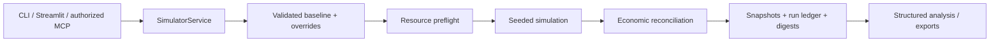
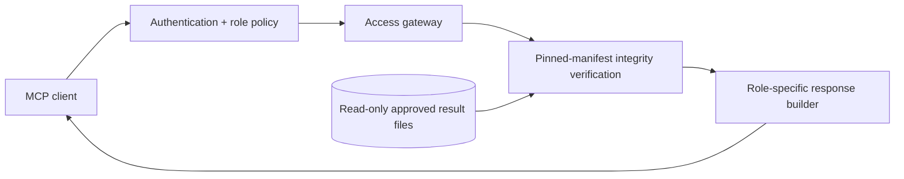

# FIGHTEX — Economic Simulation Platform

**Python · Agent-based simulation · Monte Carlo · Financial risk modeling · MCP · Docker**

FIGHTEX is a Python-based simulation platform for analyzing the economy of a digital collectible game. It models player activity, card lifecycles, staking rewards, crafting, marketplace transactions, tournament payouts, cash flow, and platform liquidity.

This is a **public engineering case study**, not the proprietary source repository. It explains the system's design, verification approach, and AI integration without exposing customer parameters, financial results, audit artifacts, credentials, or deployment details.

## Engineering highlights

- **One calculation engine, multiple interfaces.** Streamlit, CLI, and MCP use a shared application service rather than duplicating economic formulas.
- **Deterministic evidence.** Versioned configurations, seeded runs, immutable snapshots, result digests, and reconciliation checks support reproducibility.
- **Resource-aware execution.** Preflight estimation and execution limits protect expensive simulations.
- **Role-scoped MCP.** Server-side authorization distinguishes administrator access from customer-safe aggregate views.
- **Verified read-only reporting.** Approved result files are checked against a pinned integrity manifest and read without invoking the simulation engine.
- **Isolated deployment.** Docker volumes separate calculation generations; audit imports preserve historical engine provenance.

## Architecture

### Calculation pipeline

### Approved-results pipeline (no simulation)

The approved-results path does not recalculate, modify the database, or consume customer simulation quotas. A customer view is constructed from an allowlist of aggregate fields; administrative evidence remains restricted. A failed integrity check returns no result data.

## Simulation scope

| Domain | Modeled behavior |
| --- | --- |
| Players and collectibles | Onboarding, activity, churn, card issuance and expiration |
| Staking and crafting | Reward issuance and spending, crafting attempts, card transitions |
| Marketplace | Trades, matching, pricing, commissions, liquidity |
| Tournaments | Scoring, team outcomes, seeded Monte Carlo experiments |
| Bot-farm studies | Multi-account costs, realized returns, liquidation sensitivity |
| Financial model | Revenue, expenses, prizes, cash flow, obligations, operating reserve |
| Risk analysis | Scenario comparisons, parameter sensitivity, threshold crossings |

The engine distinguishes **customer-defined rules** from **behavioral assumptions**. A technically valid scenario is not a forecast or a guarantee of commercial performance.

## Production-oriented MCP design

The source project supports authenticated MCP over local stdio and HTTP. Its access gateway enforces tool permissions on each invocation, not only in the advertised tool list. A server-side read-only switch can disable simulation execution independently of the user's role.

The production architecture uses HTTPS at the edge, internal-only persistence and application services, separate data volumes for incompatible calculation generations, and an explicit rollback path. This case study does **not** disclose infrastructure addresses, credentials, token hashes, or live operational settings.

## Verification and auditability

Verification combines unit and integration tests, property-based checks, deterministic seeded comparisons, financial reconciliation, role-boundary tests, result-integrity failure tests, and isolated staging/rollback exercises. The source project's reported full test run for the October 2026 release passed **1,316 tests**; this is an internally reported result, not an independent certification or a public CI badge.

Imported historical runs retain their original engine version and digest. They are not represented as calculations performed by a newer engine. Business approval of assumptions remains distinct from technical verification.

## Documentation

- [Simulation engine](docs/ENGINE.md)
- [MCP authorization and approved-results workflow](docs/MCP.md)
- [Reproducibility and evidence chain](docs/REPRODUCIBILITY.md)
- [Engineering case study (PDF; illustrative synthetic charts)](docs/FIGHTEX_Architecture_Case_Study_EN.pdf)
- [Synthetic chart generator](tools/pdf-demo/)

## Technology

Python 3.12+, NumPy, SciPy, Pandas, Pydantic, PyYAML, SQLite, pytest, Hypothesis, Streamlit, Python MCP SDK, Docker Compose, and Nginx.

## Boundaries

This repository intentionally excludes implementation source code, full parameter sets, proprietary financial results, customer data, audit files, security-sensitive deployment details, and production secrets. Its diagrams are conceptual. Internal tests do not constitute a security certification; scenario outputs do not constitute investment advice or guaranteed returns.
