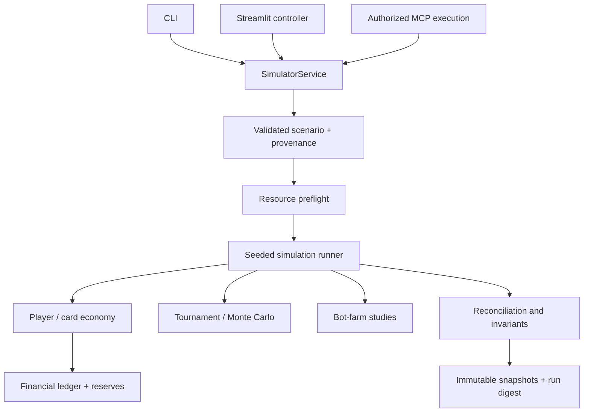

# Simulation Engine Architecture

FIGHTEX uses a Python-based seeded economic simulator for a digital collectible game. This is an architectural description, **not** the proprietary implementation or a release of customer model coefficients.

## Separation of concerns

The engine is independent of presentation and MCP transport. The read-only approved-results MCP tool is a **separate path** and does not invoke this runner; see [MCP integration](MCP.md).

## Simulation components

| Component | Responsibility |
| --- | --- |
| Configuration | Validation, versioned baseline, parameter provenance and scenario overrides |
| Population | Player onboarding, activity, churn, purchases and balances |
| Collectibles | Card issuance, per-card expiry, staking-slot effects and crafting |
| Rewards | Staking and advertising rewards, issuance/spending reconciliation |
| Marketplace | Matching, pricing, fees, liquidity and self-trade prevention |
| Tournaments | Fighter scoring, team outcomes and seeded Monte Carlo experiments |
| Bot-farm studies | Multi-account strategies, realized return and liquidation analysis |
| Finance | Revenue, prizes, operating expense, marketing, cash flow, obligations and reserves |
| Risk | Sensitivity analysis, scenario comparison and threshold crossing |
| Verification | Economic conservation checks, accounting invariants and reproducible digests |

## Daily lifecycle

The source model advances in daily steps and processes onboarding, expiry, activity and churn, rewards, purchases, crafting, tournament eligibility, marketplace transactions, withdrawals, and accounting checks. Ordering matters; for example, expiry must be handled consistently before dependent operations. Exact behavioral probabilities and proprietary customer rules are not published.

## Calculation and reporting

Supported studies include economy, tournament, bot-farm, finance, combined runs, sensitivity analysis, and repeated seeded experiments. Results carry a calculation context and warnings. Financial values are computed by Python, **not by an AI language model**.

Historical imported runs retain their original engine metadata; importing evidence into a new runtime does not constitute recalculation. Scenario assumptions are not market observations and results are not guaranteed forecasts.

## Technology

Python 3.12+, NumPy, SciPy, Pandas, Pydantic, pytest and Hypothesis. See [reproducibility](REPRODUCIBILITY.md) for the evidence model.

[← Overview](../README.md) · [MCP](MCP.md)
