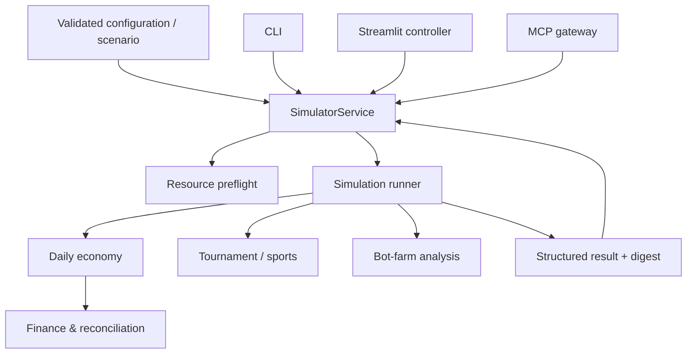

# Simulation Engine Architecture

The FIGHTEX engine is a Python-based, seeded economic simulator for a fantasy MMA/UFC-style game. This page describes the architecture, **not the proprietary implementation or customer-specific model coefficients**.

## Separation of concerns

The source project separates validated configuration, simulation, application services, storage, and presentation. The calculation path is shared by the local dashboard, CLI, and MCP interface:

The engine does not depend on the MCP transport, dashboard, or persistence layer. The simulation runner returns structured results with summary metrics, tables, warnings, and reconciliation checks.

## Model components

| Component | Role |
| --- | --- |
| Configuration | Pydantic validation, baseline loading, parameter provenance and scenario overrides |
| Daily population model | Player arrivals, activity, purchases, balances, staking, crafting, card expiry, trading and withdrawals |
| Card lifecycle | Per-card expiry and destruction, including the effects on inventory and staking slots |
| Staking and FP | Reward accrual and accounting of FP issuance and spending |
| Marketplace | Supply/demand matching, prices, commissions, and prevention of self-matches |
| Tournament | Fighter scoring, team results and Monte Carlo evaluation |
| Bot-farm model | Multi-account strategies, costs, liquidation and ROI measurements |
| Finance | Revenue, expenses, cash-flow accounting, reserves and capital requirements |
| Sensitivity | Parameter perturbations, scenario comparisons and outcome thresholds |
| Reconciliation | Cross-checks for monetary flows, cards, rewards and other invariants |

## Daily simulation lifecycle

The source model advances in daily steps. Its workflow includes onboarding, expiry, churn, staking rewards, promotions, advertising, paid and FP card packs, crafting, tournament entry, staking-slot assignment, marketplace trading, tournament rewards, withdrawals, anti-bot effects, and accounting checks.

This order matters: for example, expiry is processed before the day's other operations. This overview intentionally does not publish the full customer-specific rules or behavioral probabilities.

## Calculation modes

- **economy** — simulated player/card economy and its financial consequences.
- **tournament** — tournament and leaderboard Monte Carlo experiments.
- **botfarm** — multi-account strategy and liquidation analysis.
- **finance** — financial scenarios and capital requirements.
- **full** — combined economy, tournament and bot-farm analysis.

The source also supports one-factor sensitivity analysis and multiple seeded replications for selected studies.

## Outputs and evidence

Each result can carry the engine/configuration version, parameter hash, random seed, source of sports data, timestamp, immutable configuration snapshot, and digest. Financial figures are generated by Python, **not by the AI assistant**.

The model distinguishes rules supplied by the customer from assumptions used for scenario analysis. Results are conditional on those assumptions and should not be interpreted as guaranteed business outcomes.

## Technology

Python 3.12+, NumPy, SciPy, Pandas, Pydantic, and pytest/Hypothesis. The public documentation omits proprietary source files, actual customer parameter tables and confidential audit results.

[← Architecture overview](../README.md) · [Reproducibility](REPRODUCIBILITY.md)
