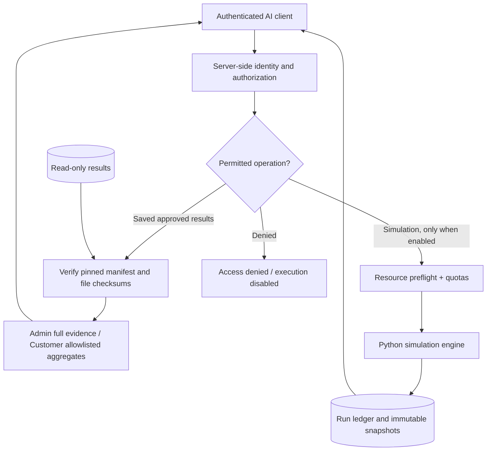
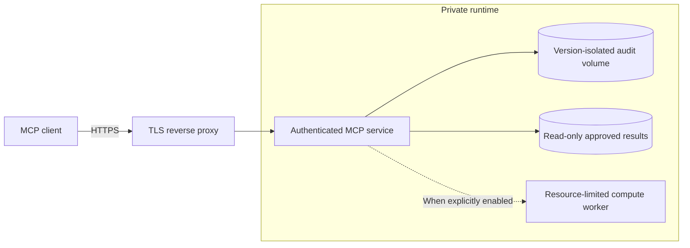

# MCP Integration and Approved-Results Access

FIGHTEX exposes structured simulation metadata and saved results through the **Model Context Protocol (MCP)**. The language model interprets evidence; the Python engine performs calculations.

## Two distinct execution paths

Approved-results retrieval is **not** a simulation request. It does not call the calculation engine, modify the run ledger or database, or decrement customer calculation quotas. File integrity is verified on each read using a manifest whose digest is pinned in application code. Tampered or missing evidence fails closed.

## Authorization boundaries

- Identity and roles are derived from authenticated server context, never client-supplied arguments.
- Tool visibility and invocation authorization are both enforced.
- Customer responses are assembled from an explicit allowlist of aggregates and caveats; internal parameter sets, hashes, run identifiers, file paths, and checksums are withheld.
- Administrative evidence is subject to administrator authorization.
- Requests for restricted parameter inclusion are rejected, rather than silently exposing additional fields.
- Read-only mode disables new calculations regardless of role.

## Deployment and version isolation

A new calculation-engine generation can use a separate data volume, importing an accepted historical audit **without recalculating it**. Imported runs retain their original engine metadata and digests. Switching versions requires a backup, validation, and a rollback path. This document intentionally omits operational addresses, secrets, and executable production deployment commands.

## Verification strategy

Role access, negative authorization cases, integrity tampering, disabled execution, database immutability, and rollback are tested separately. The source project's October 2026 release reported successful isolated Docker staging and full pytest; production OAuth login and host-specific reverse-proxy configuration require their own environment-specific checks.

## Interpretation limits

An AI assistant may explain returned values and stated assumptions but must not invent an uncomputed scenario or portray conditional outputs as forecasts. Business acceptance of financial reserve policy is separate from technical integrity.

[← Overview](../README.md) · [Evidence chain](REPRODUCIBILITY.md)
