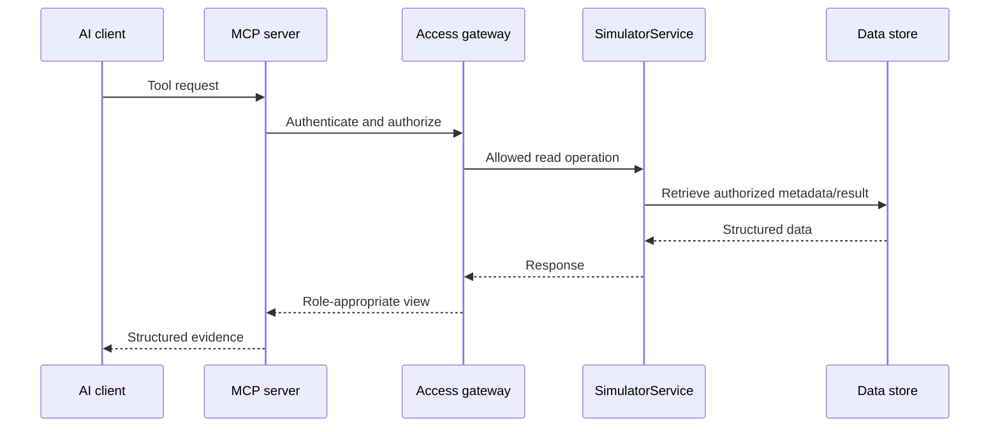
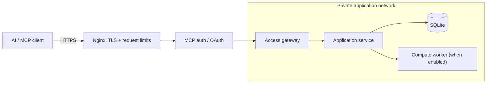

# MCP Integration Architecture

FIGHTEX exposes structured model information through the **Model Context Protocol (MCP)**. AI clients can use this interface to ask questions about model assumptions and already computed results. The Python engine, rather than the language model, performs economic calculations.

## Integration boundaries

## Interface design

The source project uses the official Python MCP SDK and supports local stdio as well as an authenticated HTTP deployment. Its tools cover:

- Model overview, parameter values, provenance and uncertainty information.
- Scenario discovery and existing run/result retrieval.
- Audit metadata, report discovery and chunked report reading.
- Where explicitly authorized and enabled, scenario and calculation operations.

Tool availability is **policy-dependent**. The production read-only setting can disable new calculations regardless of role; a customer demo policy can restrict detailed reports and results. Public documentation does not imply that all tools are enabled for every user.

## Security model

1. **Server-derived identity:** role and permissions come from authenticated server-side context, not user-supplied tool arguments.
2. **Default deny:** each tool invocation is authorized by the access gateway, independently of whether it appears in a tool listing.
3. **Data minimization:** customer previews are constructed from explicitly allowed data, rather than sending full audit results to an AI model and asking it to redact them.
4. **Input validation:** parameter paths, report names, identifiers and result selections are validated.
5. **Execution control:** a server-side read-only mode prevents new calculations through MCP.
6. **Resource boundaries:** resource estimation, limits and rate controls protect the compute service.
7. **Infrastructure isolation:** persistence and internal services are not publicly exposed.

## Deployment concept

The deployment may use OAuth or role-specific bearer credentials. The actual credential issuance, server addresses, secret hashes and infrastructure configuration are intentionally not documented here.

## Trust and interpretation

The AI client can explain a returned financial metric, identify which assumptions are documented versus estimated, and discuss hypothetical changes. It must not present an uncomputed hypothetical as an engine result. A stored run's metadata and snapshot establish what was actually calculated.

This document describes the **architecture and trust boundaries**, not a public API specification or authorization to run simulations.

[← Architecture overview](../README.md) · [Engine](ENGINE.md)
