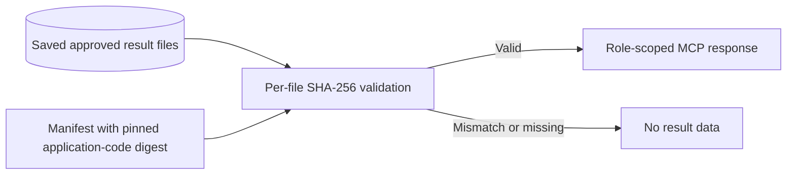

# Reproducibility, Audit Imports, and Integrity

FIGHTEX separates **calculation reproducibility**, **saved-evidence integrity**, and **customer acceptance of assumptions**.

## Calculation evidence chain

A saved run is associated with an engine version, configuration version, effective parameter hash, seed, input provenance, result digest, and a recorded execution. These identifiers allow comparisons without treating a newer engine as the author of older results.

## Approved-results integrity chain

The read-only result reader does not rerun the simulation or mutate persistence. Replacing an approved result set requires a deliberate manifest/code update and separate approval; merely replacing both a result file and its manifest is insufficient.

## Reconciliation and uncertainty

Economic invariants cover accounting consistency, reward issuance/spending, card lifecycle, marketplace flows, prize payouts, cash flow, and reserve obligations. Multiple seeds and one-factor sensitivity studies reveal variation under the **chosen assumptions**; they do not validate the real-world conversion, churn, or purchasing behavior of players.

## Historical import and rollback

Historical audit evidence can be imported into a new isolated volume without recalculation. The imported run retains its original engine version and digest. The previous runtime and volume can be preserved as a rollback target, subject to environment-specific backup verification.

## Public disclosure boundary

This document describes evidence mechanisms, not customer evidence. It intentionally excludes raw audit files, customer financial tables, actual manifests, run identifiers, parameter hashes, and production storage paths. Internal test results are not an independent audit certification.

[← Overview](../README.md) · [MCP](MCP.md)
