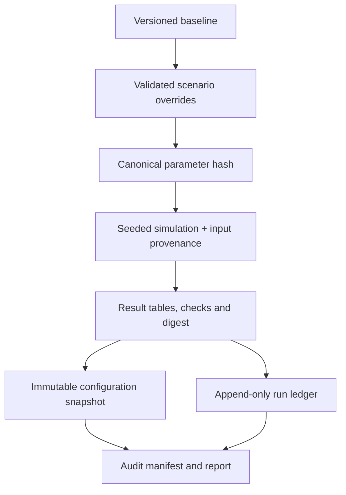

# Reproducibility and Audit Evidence

A core FIGHTEX architectural requirement is that a calculation can be traced to the exact inputs, software context and output used to produce an audit finding.

## Evidence chain

## Reproducibility metadata

The source architecture records or associates:

| Evidence | Purpose |
| --- | --- |
| Configuration version | Identifies the parameter schema and baseline generation |
| Engine version | Identifies the calculation implementation |
| Parameter hash | Identifies the effective parameter set |
| Random seed | Supports repeatable stochastic runs |
| Sports-data provenance | Distinguishes synthetic inputs from structured external data |
| Scenario / run ID | Identifies a particular saved experiment |
| Immutable parameter snapshot | Preserves effective parameter values and their sources |
| Result digest | Supports comparison of calculation outputs |
| Run ledger | Preserves a historical record of executions |
| Audit manifest and checksums | Supports integrity checks of the published evidence bundle |

## Invariants and reconciliation

The engine checks economic conservation properties and accounting relationships. These include the consistency of FP issuance/spending, card issuance/destruction, marketplace commissions, tournament payouts, cash flows and reserve requirements.

Such checks detect classes of implementation errors; they **do not prove that every behavioral assumption is correct**.

## Sensitivity and uncertainty

A single seeded run is one modeled realization. The source architecture supports comparisons across seeds and parameter perturbations, with results labeled according to their statistical basis.

- **Single seed:** one deterministic realization for a given set of inputs.
- **Multiple seeds:** descriptive variation or aggregates across repeated experiments.
- **One-factor sensitivity:** isolates the effect of changing a parameter while holding the comparison setup fixed.
- **Monte Carlo:** characterizes selected stochastic mechanisms, not necessarily uncertainty across the entire business model.

Financial claims should identify their horizon, scenario, aggregation method, and assumptions.

## Audit integrity versus business acceptance

An audit package may be technically reproducible and internally consistent while its economic assumptions still require customer confirmation. Technical readiness and business acceptance are separate decisions.

## Public documentation policy

This repository does not publish proprietary run snapshots, audit manifests, exact customer financial tables, or source datasets. It documents **how evidence is produced and preserved**, not the confidential evidence itself.

[← Architecture overview](../README.md) · [MCP integration](MCP.md)
